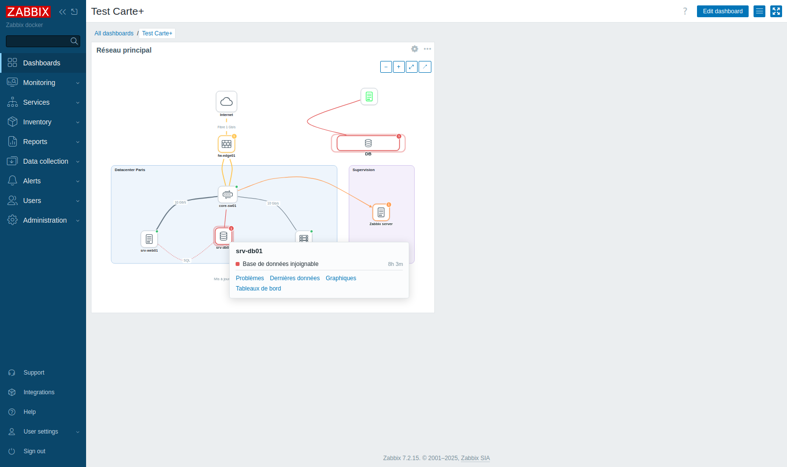

# Better Maps : cartes réseau façon draw.io pour Zabbix 7.2

Ce module frontend ajoute **Surveillance › Cartes+**, un éditeur de cartes indépendant des cartes natives de Zabbix :

- liens **courbes**, droits ou orthogonaux, qu'on plie en les attrapant à la souris ;
- gestion des liens inspirée de draw.io : points de connexion fixes ou extrémités flottantes, routage orthogonal automatique à segments déplaçables, coins arrondis, aperçu en direct pendant le tracé ;
- points de passage déplaçables (aimantés sur l'alignement de leurs voisins), extrémités reconnectables d'un nœud à un autre, libellé déplaçable le long du lien ;
- liens parallèles (LACP, redondance) écartés automatiquement ;
- hôtes Zabbix avec icônes vectorielles, pastille de statut et halo pulsant pour les problèmes Haut et Désastre ;
- icônes personnalisées (SVG, PNG, JPEG, GIF, WebP, 1 Mo au maximum) ajoutées et supprimées depuis l'éditeur, partagées par toutes les cartes ; les SVG contenant des scripts, des gestionnaires d'évènements, une DTD ou des références externes sont refusés ;
- libellé des hôtes et des groupes en bas, en haut, à gauche ou à droite (réglage par nœud, ou par défaut pour toute la carte), contourné par les liens ; ou pas d'icône du tout, le libellé étant alors écrit dans la boîte ;
- groupes d'hôtes : statut cumulé des hôtes surveillés du groupe (sévérité la plus haute, nombre de problèmes, hôtes en problème) ;
- items : dernière valeur affichée en direct (unités et tables de correspondance appliquées), statut d'après les déclencheurs de l'item ;
- déclencheurs : état OK / PROBLÈME aux couleurs de la sévérité, problèmes actifs au clic ;
- liens colorés selon la sévérité des problèmes de leurs extrémités (hôte, groupe, item ou déclencheur), ou d'un ou plusieurs autres déclencheurs choisis pour le lien, combinés en OU (au moins un en problème) ou en ET (tous en problème) ;
- zones (rectangles, ellipses) et textes libres, avec mise en forme du texte : police, taille, couleur, gras, italique, souligné, alignement horizontal (gauche, centre, droite) et vertical (haut, milieu, bas) ;
- annuler/rétablir, copier/coller (y compris entre deux cartes), alignement et répartition, grille magnétique ;
- mode visualisation : rafraîchissement automatique, popup au clic sur un nœud ou un lien (état, problèmes, liens vers les problèmes, graphiques et dernières données), plein écran ;
- export et import JSON ;
- compatible avec les thèmes clairs et sombres de Zabbix.

Le même module fournit aussi le widget **Carte+**, qui affiche ces cartes dans un tableau de bord.

## Installation

1. Copier le dossier `bettermaps/` dans le dossier `modules/` du frontend Zabbix :
   ```bash
   cp -r bettermaps /usr/share/zabbix/modules/
   ```
   Selon le mode d'installation, ce dossier peut aussi être `/usr/share/zabbix/ui/modules/` ou `/var/www/html/zabbix/modules/`. C'est le dossier qui contient déjà `widgets/`.
2. Dans Zabbix, aller dans **Administration › Général › Modules**, cliquer sur **Analyser le répertoire**, puis activer **Better Maps**.
3. Le menu **Surveillance › Cartes+** apparaît, et le type de widget **Carte+** est proposé dans les tableaux de bord.

> **Mise à jour depuis la version 1.0** (deux modules) : supprimer le dossier `bettermapswidget/`, recopier `bettermaps/`, puis cliquer sur **Analyser le répertoire**. Les widgets « Carte+ » ajoutés avec la version 1.0 sont à recréer, car le type de widget a changé de nom. Les cartes elles-mêmes sont conservées.

Au premier affichage, le module crée une table `bettermaps_map` dans la base Zabbix (PostgreSQL ou MySQL). Si l'utilisateur SQL du frontend n'a pas le droit `CREATE`, créer la table à la main avec [bettermaps/sql/create_table.sql](bettermaps/sql/create_table.sql).

> La table est sauvegardée avec le reste de la base Zabbix. Elle n'est pas touchée par les mises à jour de Zabbix.

## Droits

| Action | Condition |
|---|---|
| Voir les cartes | accès à l'interface « Surveillance › Cartes » dans le rôle |
| Créer, modifier, supprimer | type Admin ou Super admin, avec l'action « Créer et modifier les cartes » |
| Statut des hôtes, groupes, items et déclencheurs | via l'API Zabbix : chacun ne voit que les objets auxquels il a accès |

## Utilisation de l'éditeur

| Geste | Effet |
|---|---|
| + Hôte, + Groupe, + Item, + Déclencheur | ajouter un objet Zabbix, à choisir dans le panneau (pour un item ou un déclencheur : l'hôte, puis l'objet) |
| Survoler un nœud, tirer depuis un point bleu… | créer un lien, fixé à ce point |
| … et relâcher sur un point bleu d'un autre nœud | extrémité fixe (le point s'aimante à l'approche) |
| … et relâcher au milieu d'un nœud | extrémité flottante (suit le côté le plus proche) |
| … et relâcher dans le vide | crée un nouveau nœud de même apparence, déjà relié |
| Tirer un lien courbe ou droit | le courber (ajoute un point de passage) |
| Tirer un point plein / un point creux | déplacer / ajouter un point de passage |
| Tirer la poignée d'un segment orthogonal | décaler ce segment parallèlement à lui-même |
| Tirer le libellé d'un lien | le déplacer le long du lien |
| Double-clic sur un point | le supprimer |
| Double-clic sur un lien ou un nœud | modifier son libellé |
| Tirer une extrémité d'un lien sélectionné | la reconnecter (point fixe ou flottante) |
| Glisser dans le vide (Maj pour ajouter) | sélection rectangulaire |
| Molette | zoom |
| Espace + glisser, ou clic droit + glisser | déplacer la vue |
| Ctrl+Z / Ctrl+Y, Ctrl+C / Ctrl+V, Ctrl+D, Suppr, flèches, Ctrl+S | raccourcis habituels |

## Widget de tableau de bord

1. Ouvrir un tableau de bord, cliquer sur **Modifier le tableau de bord**, puis **Ajouter**.
2. Choisir le type **Carte+**, sélectionner la carte, puis valider et enregistrer le tableau de bord.



- Si le nom du widget est laissé vide, c'est le nom de la carte qui s'affiche.
- Le statut est rafraîchi selon l'intervalle du widget (30 s par défaut). Le zoom et le popup ouvert sont conservés, et les modifications de la carte sont prises en compte automatiquement.
- Le widget est en lecture seule. Un clic sur un hôte, un groupe, un item ou un déclencheur affiche ses problèmes. Les boutons de zoom apparaissent au survol, et le bouton ↗ ouvre la carte en grand.
- **Ctrl + molette** zoome. La molette seule fait défiler le tableau de bord, comme d'habitude.
- La carte se recadre quand on redimensionne le widget.

## Environnement de test

[test/docker-compose.yml](test/docker-compose.yml) lance un Zabbix 7.2 complet (PostgreSQL) avec le module monté en direct :

```bash
cd test && docker compose up -d     # http://localhost:8099  (Admin / zabbix)
```

## Structure

```
bettermaps/
├── manifest.json              module de type "widget" : pages Cartes+ + widget Carte+
├── Widget.php                 nom du widget, ajout de l'entrée de menu
├── actions/                   contrôleurs : liste, vue, création, sauvegarde, suppression,
│                              recherche d'hôtes / groupes / items / déclencheurs, statut, contenu du widget (WidgetView.php)
├── includes/                  formulaire du widget (choix de la carte, boutons de zoom)
├── lib/                       stockage SQL, statut des objets Zabbix, droits, assets, base des contrôleurs JSON
├── views/                     pages liste et carte, vue et formulaire du widget
├── assets/js/bettermap.js     l'éditeur SVG (sans dépendance)
├── assets/js/class.widget.js  classe JS du widget
├── assets/css/bettermap.css
└── sql/create_table.sql       création manuelle de la table (secours)
```

Zabbix ne charge le JS et le CSS d'un module de type widget que sur les tableaux de bord. Les pages Cartes+ les incluent donc elles-mêmes (voir `lib/Assets.php`). Les autres pages de Zabbix ne chargent pas l'éditeur.
