# Guide utilisateur : Cartes+ (Better Maps)

🌐 [English](user-guide.md) · **Français**

Cartes+ affiche des schémas de votre réseau dans Zabbix, avec l'état de chaque équipement en temps réel. On y voit d'un coup d'œil ce qui est en panne, où, et à quel point c'est grave. Un clic sur un équipement donne le détail de ses problèmes.

Ce guide s'adresse :

- à **tous les utilisateurs** qui consultent les cartes : parties [1](#1-ouvrir-une-carte) à [3](#3-afficher-une-carte-dans-un-tableau-de-bord) ;
- aux **administrateurs** qui créent et modifient les cartes : parties [4](#4-créer-une-carte) à [8](#8-raccourcis-clavier-et-souris).

Les problèmes courants sont traités dans la [foire aux questions](#9-questions-fréquentes).

## Sommaire

1. [Ouvrir une carte](#1-ouvrir-une-carte)
2. [Lire une carte](#2-lire-une-carte)
3. [Afficher une carte dans un tableau de bord](#3-afficher-une-carte-dans-un-tableau-de-bord)
4. [Créer une carte](#4-créer-une-carte)
5. [Construire la carte](#5-construire-la-carte)
6. [Relier les éléments](#6-relier-les-éléments)
7. [Mettre en page et enregistrer](#7-mettre-en-page-et-enregistrer)
8. [Raccourcis clavier et souris](#8-raccourcis-clavier-et-souris)
9. [Questions fréquentes](#9-questions-fréquentes)

---

## 1. Ouvrir une carte

Dans le menu de Zabbix, ouvrez **Surveillance › Cartes+**. La liste de toutes les cartes s'affiche, avec la date de leur dernière modification.

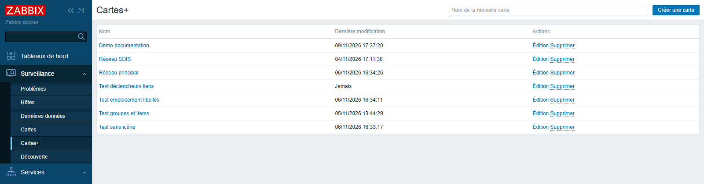

Cliquez sur le nom d'une carte pour l'ouvrir. Le lien **← Toutes les cartes**, en haut de chaque carte, ramène à cette liste.

> Le menu **Cartes+** n'apparaît que si votre rôle Zabbix donne accès aux cartes (**Surveillance › Cartes**). Si vous ne le voyez pas, adressez-vous à votre administrateur Zabbix.

## 2. Lire une carte

Une carte s'ouvre en mode **Voir**. Rien ne peut y être modifié par erreur.

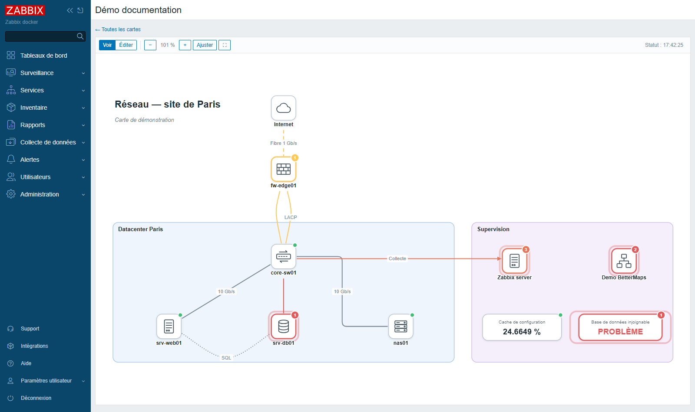

### La barre d'outils

| Bouton | Rôle |
|---|---|
| **Voir** / **Éditer** | passer en lecture ou en modification (**Éditer** n'apparaît que pour les administrateurs) |
| **−** / **+** | dézoomer, zoomer |
| **85 %** | niveau de zoom ; un clic revient à 100 % |
| **Ajuster** | afficher toute la carte dans la fenêtre |
| **⛶** | plein écran (touche Échap pour en sortir) |
| **Statut : 17:33:14** | heure de la dernière mise à jour des états |

Les états sont mis à jour automatiquement, toutes les 30 secondes par défaut. Inutile de recharger la page.

Pour se déplacer dans la carte :

- **molette** : zoomer ou dézoomer autour du pointeur ;
- **cliquer-glisser** dans la carte : la faire défiler.

### Ce que signifient les couleurs

Un élément relié à Zabbix (hôte, groupe, item ou déclencheur) change d'aspect selon son état :

| Aspect | Signification |
|---|---|
| petite pastille **verte** en haut à droite | tout va bien, aucun problème |
| bordure colorée et **pastille numérotée** | il y a des problèmes ; le chiffre en donne le nombre, la couleur la sévérité la plus haute |
| **halo** autour de l'élément | au moins un problème de sévérité **Haut** ou **Désastre** |
| pastille violette **M** | en maintenance |
| élément **estompé**, sans pastille | désactivé dans Zabbix |
| élément estompé, **bordure en pointillés** | objet introuvable (supprimé, ou vous n'avez pas le droit de le voir), item non supporté ou déclencheur dans un état inconnu ; une boîte item ou déclencheur introuvable affiche **?** |

Les couleurs des sévérités sont celles de Zabbix :

| Sévérité | Couleur |
|---|---|
| Non classé | gris |
| Information | bleu |
| Avertissement | jaune |
| Moyen | orange clair |
| Haut | orange foncé |
| Désastre | rouge |

Les **liens** entre les éléments se colorent eux aussi quand un problème les concerne : par exemple, le lien vers un serveur en panne devient rouge. Les liens gris ne signalent rien.

> Les problèmes masqués (suppressed) et les problèmes marqués comme symptômes ne sont pas comptés. Les problèmes acquittés restent comptés ; ils sont suivis d'une coche ✓ dans les fenêtres de détail.

### Les éléments d'une carte

| Élément | Ce qu'il montre |
|---|---|
| **Hôte** (icône d'équipement) | l'état de l'hôte : ses problèmes en cours |
| **Groupe d'hôtes** | l'état cumulé de tous les hôtes surveillés du groupe |
| **Item** (boîte avec une valeur) | la dernière valeur relevée, par exemple « 24.66 % », avec son unité ; « — » s'il n'y a pas encore de donnée |
| **Déclencheur** (boîte avec un état) | **OK** en vert, ou **PROBLÈME** dans la couleur de sa sévérité |
| **Zones, ellipses, textes** | de la mise en forme : sites, salles, titres, commentaires |

Un groupe n'est considéré « en maintenance » que si **tous** ses hôtes surveillés le sont.

Survoler un élément affiche une info-bulle avec son nom complet et la liste de ses problèmes.

### Voir le détail : cliquer sur un élément

Un clic sur un hôte, un groupe, un item ou un déclencheur ouvre une fenêtre de détail :

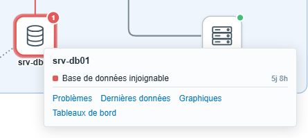

Elle indique :

- la liste des problèmes en cours, du plus grave au plus récent, avec leur ancienneté (5j 8h = depuis 5 jours et 8 heures) ;
- des liens vers les pages Zabbix utiles : **Problèmes**, **Dernières données**, **Graphiques**, **Tableaux de bord** de l'hôte.

Pour un **groupe**, la fenêtre indique aussi le nombre d'hôtes surveillés et combien sont en problème. Chaque problème est précédé du nom de l'hôte concerné.

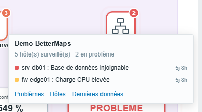

Pour un **item**, elle affiche la valeur et son ancienneté, avec un lien vers le **Graphique** (ou l'**Historique** pour les valeurs texte).

Un clic sur un **lien coloré** explique pourquoi il est coloré : les éléments ou déclencheurs qui le pilotent, leur état, et les problèmes en cours.

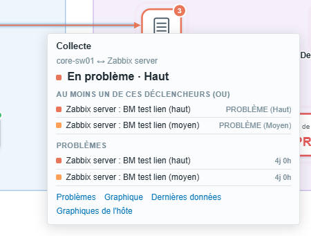

La fenêtre se met à jour toute seule tant qu'elle reste ouverte. Pour la fermer, cliquez dans le vide ou appuyez sur Échap.

Certains éléments renvoient vers une autre page (une autre carte, un site web…). Pour une zone ou un texte, le clic ouvre directement cette page. Pour un élément Zabbix, un lien **Lien** est ajouté en bas de sa fenêtre de détail.

## 3. Afficher une carte dans un tableau de bord

Une carte peut être placée dans un tableau de bord Zabbix grâce au widget **Carte+**.

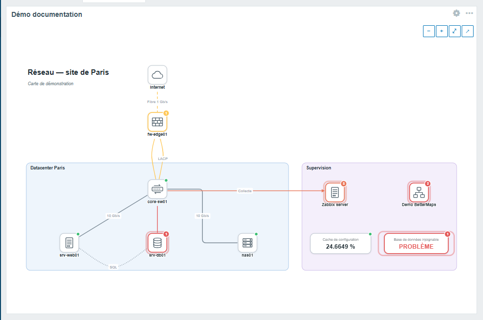

**Ajouter le widget :**

1. Ouvrez le tableau de bord, puis cliquez sur **Editer le tableau de bord**.
2. Cliquez sur **Ajouter**, puis choisissez le type **Carte+**.
3. Dans **Carte**, sélectionnez la carte à afficher. Décochez **Boutons de zoom** si vous ne voulez pas de boutons sur la carte.
4. Validez le widget, puis enregistrez le tableau de bord.

Si vous laissez le **Nom** du widget vide, c'est le nom de la carte qui s'affiche en titre.

**Utiliser le widget :**

- le widget est en lecture seule ; un clic sur un élément ouvre sa fenêtre de détail, comme sur la carte ;
- **Ctrl + molette** zoome sur la carte. La molette seule fait défiler le tableau de bord, comme d'habitude ;
- les boutons **−**, **+**, **⤢** (toute la carte) et **↗** (ouvrir la carte en grand) apparaissent au survol ;
- les états sont rafraîchis selon l'intervalle du widget (30 secondes par défaut). Les modifications faites sur la carte apparaissent aussi automatiquement ;
- la carte se recadre quand on redimensionne le widget.

---

> **Les parties suivantes concernent les administrateurs.** Pour créer, modifier ou supprimer une carte, il faut un compte de type **Admin** ou **Super admin** dont le rôle autorise l'action **Créer et modifier les cartes**.

## 4. Créer une carte

1. Ouvrez **Surveillance › Cartes+**.
2. Saisissez un nom dans le champ **Nom de la nouvelle carte**, en haut à droite.
3. Cliquez sur **Créer une carte** (ou appuyez sur Entrée).

La carte vide s'ouvre directement en mode **Éditer**.

Depuis la liste, le lien **Édition** ouvre une carte en mode modification, et **Supprimer** la supprime après confirmation.

> **Attention :** la suppression est définitive. Les widgets de tableau de bord qui affichaient cette carte indiqueront « Carte introuvable ».

## 5. Construire la carte

### L'écran d'édition

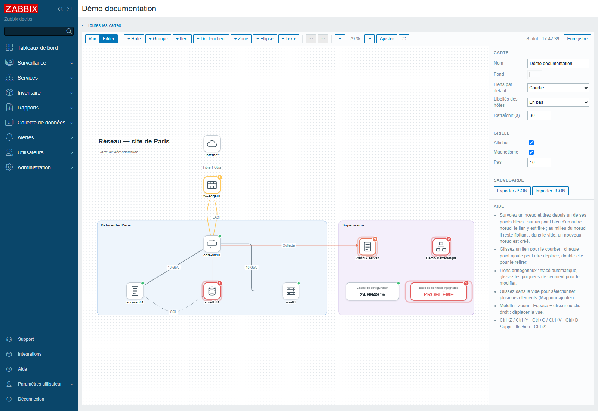

En mode **Éditer**, l'écran comprend :

- la **barre d'outils** avec les boutons d'ajout, d'annulation et le bouton **Enregistrer** ;
- la **carte**, avec une grille de points pour aider à aligner les éléments ;
- le **panneau de droite**, qui affiche les réglages de ce qui est sélectionné. Si rien n'est sélectionné, il affiche les réglages de la carte entière et un aide-mémoire.

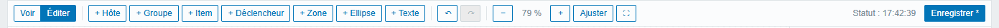

Le bouton tout à droite indique où en est la sauvegarde : **Enregistré**, ou **Enregistrer \*** s'il reste des modifications à enregistrer.

### Ajouter un hôte ou un groupe

1. Cliquez sur **+ Hôte** (ou **+ Groupe**). Un nouvel élément apparaît au centre de la vue et le panneau de droite s'ouvre.
2. Dans le champ **Hôte** (ou **Groupe**), tapez quelques lettres du nom, puis choisissez dans la liste.

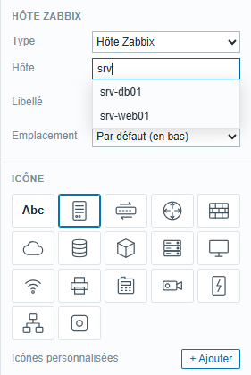

L'élément prend aussitôt l'état de l'objet choisi. Par défaut, il est nommé comme l'hôte ou le groupe dans Zabbix. Le champ **Libellé** permet d'afficher un autre nom.

### Ajouter un item ou un déclencheur

1. Cliquez sur **+ Item** (ou **+ Déclencheur**).
2. Choisissez d'abord l'**Hôte**.
3. Choisissez ensuite l'**Item** (recherche sur le nom ou la clé) ou le **Déclencheur** de cet hôte.

Un item affiche sa dernière valeur. Il est coloré selon les déclencheurs qui l'utilisent. Un déclencheur affiche OK ou PROBLÈME.

### Ajouter des zones et des textes

- **+ Zone** : un rectangle, pour délimiter un site, une salle, une baie. Les zones restent toujours derrière les équipements.
- **+ Ellipse** : la même chose, en ovale.
- **+ Texte** : un texte libre, pour un titre ou un commentaire.

Pour les zones et les textes, le panneau **Mise en forme du texte** permet de choisir la police, la taille, la couleur, le gras (**G**), l'italique (**I**), le souligné (**S**) et l'alignement du texte dans la boîte.

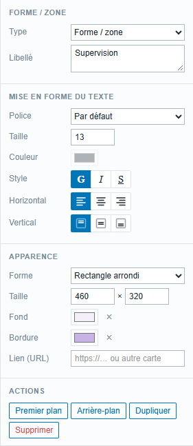

Pour saisir un texte sur plusieurs lignes, utilisez la touche Entrée dans le champ **Libellé**.

### Modifier l'apparence d'un élément

Sélectionnez l'élément d'un clic : le panneau de droite affiche ses réglages.

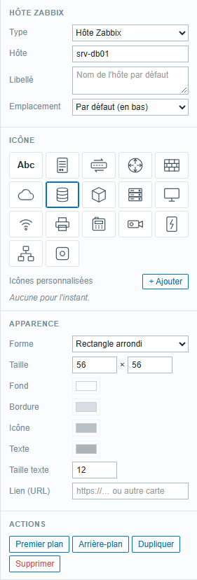

- **Type** : transformer l'élément (par exemple un hôte en groupe).
- **Libellé** : le nom affiché. Laissé vide, c'est le nom Zabbix. Un double-clic sur l'élément, dans la carte, permet aussi de le modifier.
- **Emplacement** : position du nom autour de l'icône (en bas, en haut, à gauche, à droite). **Par défaut** reprend le réglage de la carte.
- **Icône** : choisissez parmi les icônes proposées : serveur, switch, routeur, pare-feu, cloud, base de données, VM, stockage, poste de travail, borne Wi-Fi, imprimante, téléphone IP, caméra, onduleur, groupe, générique.
  - **Abc** (aucune icône) : le nom est écrit directement dans une boîte, sans pictogramme. C'est pratique pour un schéma très compact.
- **Forme**, **Taille**, **Fond**, **Bordure**, couleur de l'**Icône** et du **Texte**, **Taille texte**. La petite croix **×** à côté d'une couleur rétablit la couleur par défaut.
- **Lien (URL)** : adresse ouverte au clic en mode Voir. Collez par exemple l'adresse d'une autre carte pour naviguer de carte en carte (vue d'ensemble → détail d'un site).

Pour agrandir un élément, vous pouvez aussi tirer le petit carré qui apparaît en bas à droite quand il est sélectionné.

### Utiliser vos propres icônes

Sous les icônes proposées, la rubrique **Icônes personnalisées** permet d'ajouter vos images :

1. Cliquez sur **+ Ajouter** et choisissez un ou plusieurs fichiers. Formats acceptés : SVG, PNG, JPEG, GIF, WebP, 1 Mo au maximum par fichier.
2. L'icône apparaît dans la liste ; cliquez dessus pour l'appliquer à l'élément sélectionné.

Les icônes ajoutées sont partagées par **toutes les cartes**. Pour en supprimer une, survolez-la et cliquez sur la petite croix. Partout où elle était utilisée, l'icône générique la remplace.

> Pour des raisons de sécurité, les fichiers SVG qui contiennent des scripts ou font appel à des ressources externes sont refusés.

### Les actions sur un élément

En bas du panneau :

- **Premier plan** / **Arrière-plan** : passer l'élément devant ou derrière les autres ;
- **Dupliquer** (Ctrl+D) : en créer une copie ;
- **Supprimer** (touche Suppr) : le retirer de la carte, avec les liens qui y sont attachés.

## 6. Relier les éléments

### Tracer un lien

1. Survolez un élément : des **points bleus** apparaissent sur son pourtour.

   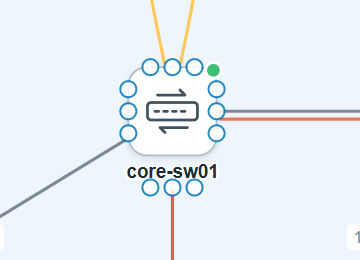

2. Cliquez sur un point bleu et, sans relâcher, tirez vers l'élément à relier. Un aperçu du lien suit le pointeur.

   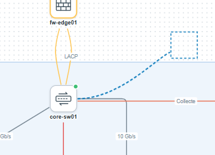

3. Relâchez :
   - **sur un point bleu** de l'autre élément : le lien est accroché à ce point précis ;
   - **au milieu** de l'autre élément : le lien est « flottant ». Il part toujours du côté le plus proche, même si vous déplacez les éléments ;
   - **dans le vide** : un nouvel élément identique au premier est créé au bout du lien. C'est pratique pour dessiner vite plusieurs équipements semblables.

Si vous tracez plusieurs liens entre les deux mêmes éléments (agrégat de liens, liens redondants), ils s'écartent automatiquement l'un de l'autre.

### Choisir la forme du lien

Cliquez sur un lien pour le sélectionner. Le panneau de droite affiche ses réglages.

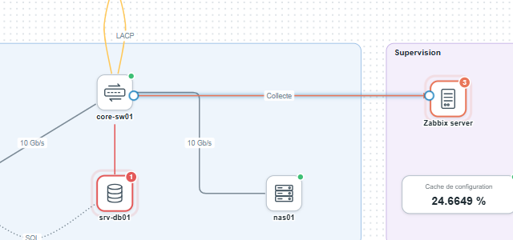

Le champ **Tracé** propose trois formes :

- **Courbe** : un trait souple. Tirez le lien avec la souris pour le courber ;
- **Droit** : une ligne droite. Tirez-le pour ajouter un coude ;
- **Orthogonal** : uniquement des segments horizontaux et verticaux, tracés automatiquement. Tirez la poignée au milieu d'un segment pour le décaler, double-cliquez-la pour supprimer ce décrochement.

Pour les liens droits et orthogonaux, **Coins arrondis** adoucit les angles.

Sur un lien sélectionné :

- les **points pleins** sont les points de passage : tirez-les pour les déplacer, double-cliquez pour les supprimer ;
- les **points creux** au milieu de chaque tronçon : tirez-les pour ajouter un point de passage ;
- les **extrémités** : tirez-les vers un autre élément pour rebrancher le lien ;
- le **libellé** (par exemple « 10 Gb/s ») : tirez-le pour le faire glisser le long du lien.

Le bouton **Redresser** supprime tous les points de passage. **Inverser** change le sens du lien, ce qui est utile avec les flèches.

### Régler l'apparence du lien

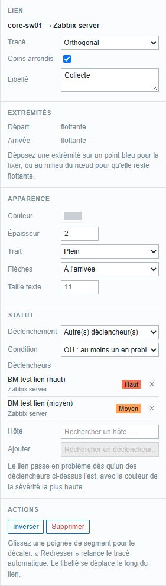

- **Libellé** : texte affiché sur le lien (débit, type de connexion…). Un double-clic sur le lien permet aussi de le saisir.
- **Extrémités** : indique si chaque bout est accroché à un point fixe ou flottant. **Libérer** rend une extrémité flottante.
- **Couleur**, **Épaisseur**, **Trait** (plein, tirets, pointillés), **Flèches** (aucune, à l'arrivée, au départ, aux deux bouts), **Taille texte**.

### Choisir ce qui colore le lien

La rubrique **Statut**, champ **Déclenchement**, définit quand le lien change de couleur :

| Choix | Le lien se colore quand… |
|---|---|
| **Les deux extrémités** (par défaut) | l'un ou l'autre des éléments reliés a un problème |
| **Le nœud de départ** | seul l'élément de départ a un problème |
| **Le nœud d'arrivée** | seul l'élément d'arrivée a un problème |
| **Autre(s) déclencheur(s)** | un ou plusieurs déclencheurs choisis exprès pour ce lien sont en problème |
| **Jamais** | jamais : le lien reste de sa couleur normale (par exemple un lien purement indicatif) |

Le lien prend la couleur de la sévérité la plus haute.

Avec **Autre(s) déclencheur(s)**, le lien peut refléter précisément l'état de la liaison, par exemple le déclencheur « interface Gi0/1 down » du switch, plutôt que l'état général des équipements :

1. Dans **Hôte**, choisissez l'hôte qui porte le déclencheur.
2. Dans **Ajouter**, choisissez le déclencheur. Il s'ajoute à la liste, avec son état actuel.
3. Recommencez pour ajouter d'autres déclencheurs, éventuellement d'autres hôtes. La croix **×** en retire un.
4. Avec plusieurs déclencheurs, choisissez la **Condition** :
   - **OU** : le lien se colore dès qu'**au moins un** déclencheur est en problème ;
   - **ET** : le lien ne se colore que si **tous** les déclencheurs sont en problème. C'est utile pour des liens redondants : on n'alerte que si les deux chemins sont coupés.

## 7. Mettre en page et enregistrer

### Sélectionner plusieurs éléments

- Cliquer-glisser **dans le vide** trace un rectangle de sélection ; tout ce qui est entièrement à l'intérieur est sélectionné.
- **Maj + clic** ajoute ou retire un élément de la sélection. **Maj + rectangle** ajoute à la sélection existante.
- **Alt + cliquer-glisser** trace un rectangle même en partant d'une zone. C'est utile pour sélectionner les équipements posés dans une zone sans déplacer la zone.
- **Ctrl+A** sélectionne tout.

Avec plusieurs éléments sélectionnés, le panneau propose :

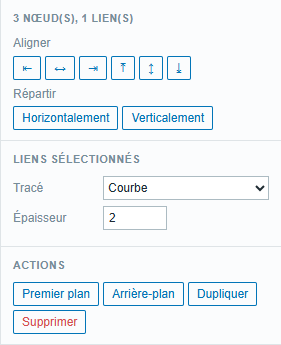

- **Aligner** : à gauche, au centre, à droite, en haut, au milieu, en bas ;
- **Répartir** horizontalement ou verticalement, à intervalles réguliers (à partir de trois éléments) ;
- pour les liens sélectionnés : changer d'un coup leur **Tracé** et leur **Épaisseur**.

On peut déplacer la sélection à la souris, ou avec les **flèches** du clavier (1 pixel, ou 10 pixels avec Maj).

### Copier, coller, annuler

- **Ctrl+C** / **Ctrl+V** : copier-coller des éléments, **y compris d'une carte à l'autre** (ouvrez l'autre carte, puis collez).
- **Ctrl+Z** / **Ctrl+Y** (ou les boutons **↶** **↷**) : annuler, rétablir.

### Réglages de la carte

Cliquez dans le vide pour tout désélectionner : le panneau affiche les réglages de la carte.

- **Nom** de la carte ;
- **Fond** : couleur de fond ;
- **Liens par défaut** : forme des nouveaux liens (courbe, droit, orthogonal) ;
- **Libellés des hôtes** : position par défaut des noms (en bas, en haut, à gauche, à droite) ;
- **Rafraîchir (s)** : fréquence de mise à jour des états, de 10 à 3 600 secondes ;
- **Grille** : **Afficher** la grille, activer le **Magnétisme** (les éléments s'accrochent à la grille) et régler son **Pas**.

### Enregistrer

Cliquez sur **Enregistrer** ou appuyez sur **Ctrl+S**. Le message « Carte enregistrée » confirme la sauvegarde.

Si vous quittez la page avec des modifications non enregistrées, le navigateur vous demande confirmation.

> **Une seule personne à la fois.** Si deux administrateurs modifient la même carte en même temps, c'est le dernier à enregistrer qui l'emporte : les modifications de l'autre sont perdues. Convenez de qui modifie quelle carte.

### Sauvegarder ou dupliquer une carte

Dans les réglages de la carte, rubrique **Sauvegarde** :

- **Exporter JSON** télécharge la carte dans un fichier ;
- **Importer JSON** remplace le contenu de la carte ouverte par celui d'un fichier. Pensez ensuite à **Enregistrer**. En cas d'erreur, **Ctrl+Z** annule l'import.

Pour dupliquer une carte : créez une carte vide, puis importez-y le fichier exporté de la carte d'origine.

## 8. Raccourcis clavier et souris

### Dans toutes les cartes

| Geste | Effet |
|---|---|
| Molette | zoomer, dézoomer |
| Maj + molette | défilement horizontal |
| Cliquer-glisser (mode Voir) | faire défiler la carte |
| Clic sur un élément ou un lien | fenêtre de détail (mode Voir) |
| Échap | fermer la fenêtre de détail, désélectionner |

### En mode Éditer

| Geste | Effet |
|---|---|
| Clic | sélectionner |
| Maj + clic | ajouter à la sélection ou en retirer |
| Glisser dans le vide | sélection rectangulaire (Maj : ajouter à la sélection) |
| Alt + glisser | sélection rectangulaire, même en partant d'une zone |
| Espace + glisser, ou clic droit + glisser | faire défiler la carte |
| Double-clic sur un élément ou un lien | modifier son libellé |
| Double-clic sur un point de passage | le supprimer |
| Double-clic sur la poignée d'un segment orthogonal | supprimer ce décrochement |
| Tirer depuis un point bleu | créer un lien |
| Flèches (Maj : par 10) | déplacer la sélection |
| Ctrl+A | tout sélectionner |
| Ctrl+C / Ctrl+V | copier / coller (aussi entre deux cartes) |
| Ctrl+D | dupliquer |
| Suppr | supprimer la sélection |
| Ctrl+Z / Ctrl+Y | annuler / rétablir |
| Ctrl+S | enregistrer |

### Dans un widget de tableau de bord

| Geste | Effet |
|---|---|
| Ctrl + molette | zoomer, dézoomer |
| Clic sur un élément | fenêtre de détail |

## 9. Questions fréquentes

**Un élément affiche « ? » ou « introuvable ou non autorisé ».**
L'objet Zabbix a été supprimé, ou votre compte n'a pas le droit de le voir. Chaque utilisateur ne voit l'état que des hôtes auxquels ses groupes d'utilisateurs donnent accès. Deux personnes peuvent donc voir la même carte avec des informations différentes.

**Un hôte est en panne mais n'apparaît pas en rouge.**
Vérifiez dans **Surveillance › Problèmes** que le problème n'est pas masqué (par exemple pendant une maintenance) ou marqué comme symptôme : ces problèmes ne sont pas comptés. Vérifiez aussi l'heure **Statut** dans la barre d'outils, qui doit avancer toutes les 30 secondes environ.

**Un item affiche « — ».**
Zabbix n'a encore reçu aucune valeur pour cet item. S'il affiche « Item non supporté » dans sa fenêtre de détail, l'item est en erreur dans Zabbix.

**Le message « Réponse inattendue du serveur (session expirée ou droits insuffisants ?) » s'affiche.**
Votre session Zabbix a expiré. Rechargez la page et reconnectez-vous. Si vous étiez en train de modifier une carte, exportez-la d'abord en JSON pour ne rien perdre.

**Je ne vois pas le bouton Éditer.**
La modification est réservée aux comptes Admin et Super admin qui ont le droit « Créer et modifier les cartes ». Les autres utilisateurs consultent les cartes en lecture seule.

**Qui voit mes cartes ?**
Toutes les cartes sont visibles par tous les utilisateurs qui ont accès à **Cartes+**. Il n'y a pas de carte privée.

**La molette ne zoome pas dans le tableau de bord.**
C'est voulu : dans un tableau de bord, la molette fait défiler la page. Utilisez **Ctrl + molette**, ou les boutons qui apparaissent au survol de la carte.

**Le widget indique « Carte introuvable ».**
La carte a été supprimée. Modifiez le widget pour choisir une autre carte.
