# User guide: Maps+ (Better Maps)

🌐 **English** · [Français](guide-utilisateur.md)

Maps+ shows diagrams of your network in Zabbix, with the state of each device in real time. You can see at a glance what is down, where, and how serious it is. Clicking a device shows the details of its problems.

> The screenshots in this guide show the interface in French. In English, the menu is called **Maps+**, the widget **Map+**, and the buttons and fields carry the English names used in this guide.

This guide is intended for:

- **all users** who view maps: parts [1](#1-opening-a-map) to [3](#3-showing-a-map-on-a-dashboard);
- **administrators** who create and edit maps: parts [4](#4-creating-a-map) to [8](#8-keyboard-and-mouse-shortcuts).

Common issues are covered in the [FAQ](#9-frequently-asked-questions).

## Contents

1. [Opening a map](#1-opening-a-map)
2. [Reading a map](#2-reading-a-map)
3. [Showing a map on a dashboard](#3-showing-a-map-on-a-dashboard)
4. [Creating a map](#4-creating-a-map)
5. [Building the map](#5-building-the-map)
6. [Linking elements](#6-linking-elements)
7. [Laying out and saving](#7-laying-out-and-saving)
8. [Keyboard and mouse shortcuts](#8-keyboard-and-mouse-shortcuts)
9. [Frequently asked questions](#9-frequently-asked-questions)

---

## 1. Opening a map

In the Zabbix menu, open **Monitoring › Maps+**. The list of all maps is shown, with the date they were last modified.

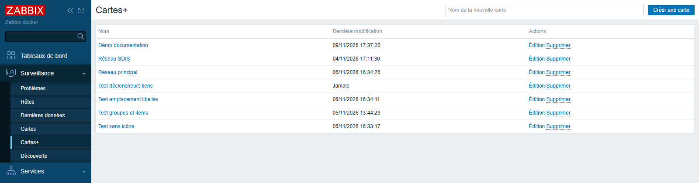

Click the name of a map to open it. The **← All maps** link, at the top of each map, takes you back to this list.

> The **Maps+** menu only appears if your Zabbix role gives access to maps (**Monitoring › Maps**). If you do not see it, contact your Zabbix administrator.

## 2. Reading a map

A map opens in **View** mode. Nothing can be changed by mistake.

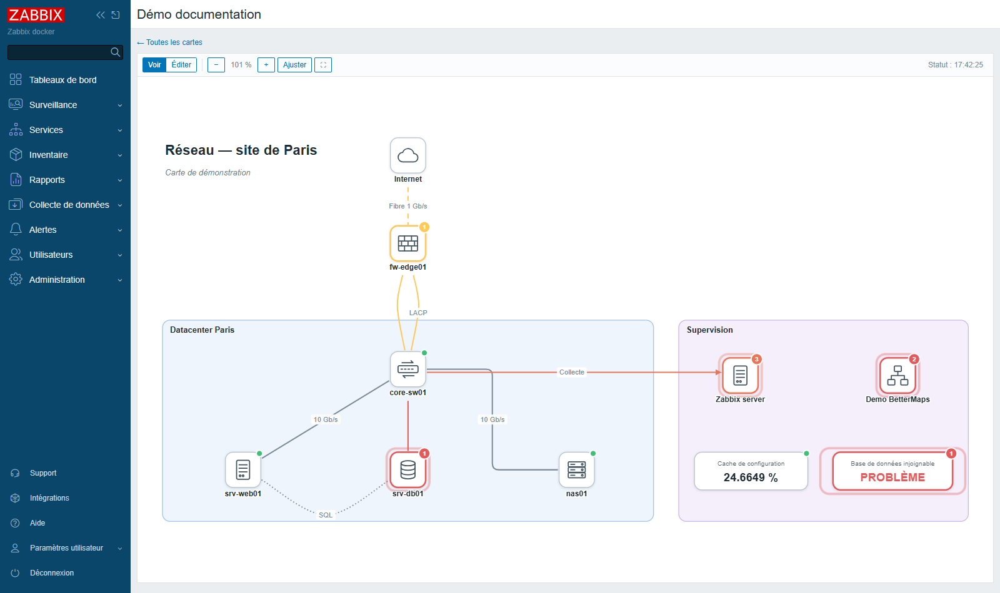

### The toolbar

| Button | Purpose |
|---|---|
| **View** / **Edit** | switch between reading and editing (**Edit** only appears for administrators) |
| **−** / **+** | zoom out, zoom in |
| **85 %** | zoom level; one click goes back to 100% |
| **Fit** | show the whole map in the window |
| **⛶** | full screen (press Esc to leave) |
| **Status: 5:33:14 PM** | time of the last status update |

Statuses are updated automatically, every 30 seconds by default. There is no need to reload the page.

To move around the map:

- **mouse wheel**: zoom in or out around the pointer;
- **click and drag** in the map: scroll it.

### What the colours mean

An element linked to Zabbix (host, group, item or trigger) changes appearance according to its state:

| Appearance | Meaning |
|---|---|
| small **green** dot at the top right | all is well, no problems |
| coloured border and **numbered badge** | there are problems; the number gives how many, the colour the highest severity |
| **halo** around the element | at least one problem of severity **High** or **Disaster** |
| purple **M** badge | in maintenance |
| **faded** element, no badge | disabled in Zabbix |
| faded element, **dotted border** | object not found (deleted, or you are not allowed to see it), unsupported item or trigger in an unknown state; an item or trigger box that cannot be found shows **?** |

Severity colours are those of Zabbix:

| Severity | Colour |
|---|---|
| Not classified | grey |
| Information | blue |
| Warning | yellow |
| Average | light orange |
| High | dark orange |
| Disaster | red |

**Links** between elements are also coloured when a problem concerns them: for example, the link to a failed server turns red. Grey links signal nothing.

> Suppressed problems and problems marked as symptoms are not counted. Acknowledged problems are still counted; they are followed by a ✓ tick in the detail windows.

### The elements of a map

| Element | What it shows |
|---|---|
| **Host** (device icon) | the state of the host: its current problems |
| **Host group** | the combined state of all the monitored hosts in the group |
| **Item** (box with a value) | the latest value collected, for example "24.66 %", with its unit; "—" if there is no data yet |
| **Trigger** (box with a state) | **OK** in green, or **PROBLEM** in the colour of its severity |
| **Areas, ellipses, text** | layout: sites, rooms, titles, comments |

A group is only considered "in maintenance" if **all** of its monitored hosts are.

Hovering over an element shows a tooltip with its full name and the list of its problems.

### Seeing the details: clicking an element

Clicking a host, group, item or trigger opens a detail window:

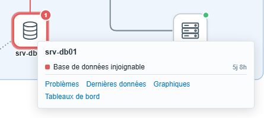

It shows:

- the list of current problems, from the most severe to the most recent, with their age (5d 8h = for 5 days and 8 hours);
- links to the relevant Zabbix pages: the host's **Problems**, **Latest data**, **Graphs** and **Dashboards**.

For a **group**, the window also shows the number of monitored hosts and how many are in problem. Each problem is preceded by the name of the host concerned.

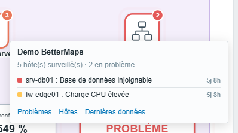

For an **item**, it shows the value and its age, with a link to the **Graph** (or the **History** for text values).

Clicking a **coloured link** explains why it is coloured: the elements or triggers that drive it, their state, and the current problems.

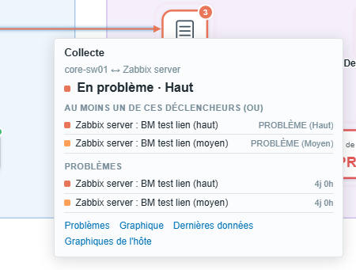

The window updates itself as long as it stays open. To close it, click in empty space or press Esc.

Some elements point to another page (another map, a website…). For an area or a text, clicking opens that page directly. For a Zabbix element, a **Link** link is added at the bottom of its detail window.

## 3. Showing a map on a dashboard

A map can be placed on a Zabbix dashboard with the **Map+** widget.

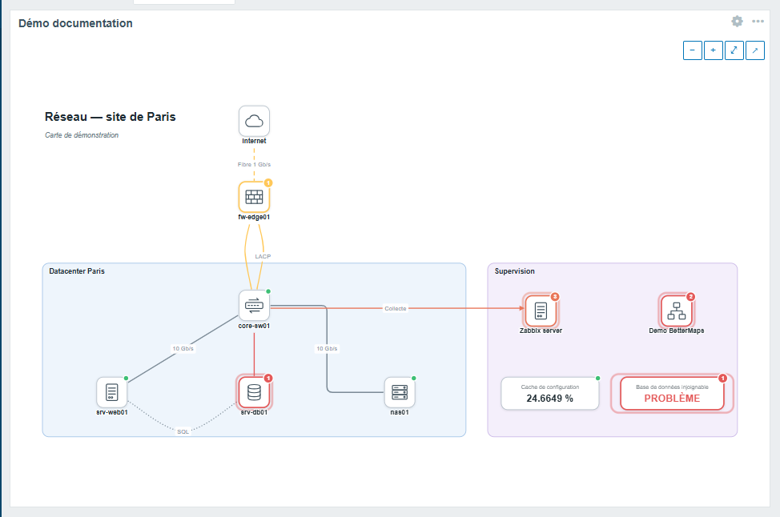

**Adding the widget:**

1. Open the dashboard, then click **Edit dashboard**.
2. Click **Add**, then choose the **Map+** type.
3. In **Map**, select the map to display. Clear **Zoom buttons** if you do not want buttons on the map.
4. Apply the widget, then save the dashboard.

If you leave the widget **Name** empty, the map name is shown as the title.

**Using the widget:**

- the widget is read-only; clicking an element opens its detail window, as on the map;
- **Ctrl + mouse wheel** zooms the map. The mouse wheel alone scrolls the dashboard, as usual;
- the **−**, **+**, **⤢** (whole map) and **↗** (open the full map) buttons appear on hover;
- statuses are refreshed according to the widget's refresh interval (30 seconds by default). Changes made to the map also appear automatically;
- the map is refitted when the widget is resized.

---

> **The following parts are for administrators.** To create, edit or delete a map, you need an **Admin** or **Super admin** account whose role allows the **Create and edit maps** action.

## 4. Creating a map

1. Open **Monitoring › Maps+**.
2. Type a name in the **New map name** field, at the top right.
3. Click **Create map** (or press Enter).

The empty map opens directly in **Edit** mode.

From the list, the **Edit** link opens a map in edit mode, and **Delete** deletes it after confirmation.

> **Warning:** deletion is permanent. Dashboard widgets that showed this map will display "Map not found".

## 5. Building the map

### The editing screen

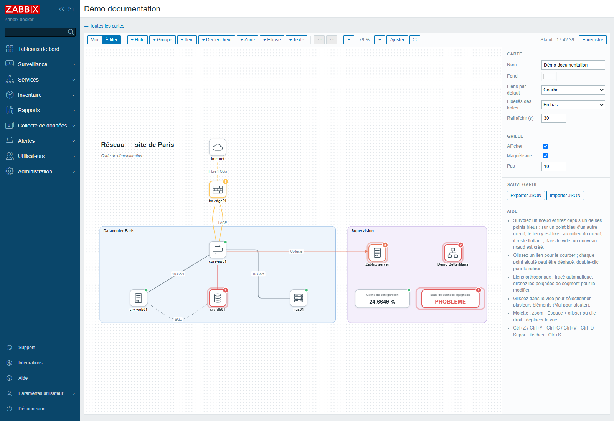

In **Edit** mode, the screen contains:

- the **toolbar**, with the add buttons, undo/redo and the **Save** button;
- the **map**, with a dot grid to help align elements;
- the **right-hand panel**, which shows the settings of whatever is selected. When nothing is selected, it shows the settings of the whole map and a quick reference.

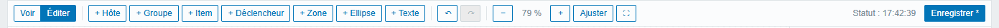

The rightmost button shows the save status: **Saved**, or **Save \*** if there are changes left to save.

### Adding a host or a group

1. Click **+ Host** (or **+ Group**). A new element appears in the middle of the view and the right-hand panel opens.
2. In the **Host** (or **Group**) field, type a few letters of the name, then pick it from the list.

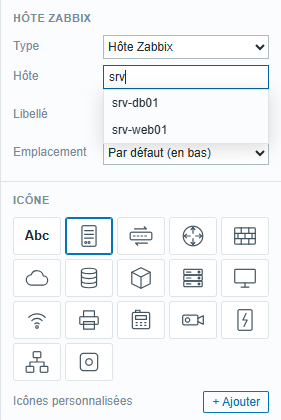

The element immediately takes on the state of the chosen object. By default, it is named like the host or group in Zabbix. The **Label** field lets you show another name.

### Adding an item or a trigger

1. Click **+ Item** (or **+ Trigger**).
2. First choose the **Host**.
3. Then choose the **Item** (search by name or key) or the **Trigger** of that host.

An item shows its latest value. It is coloured according to the triggers that use it. A trigger shows OK or PROBLEM.

### Adding areas and text

- **+ Area**: a rectangle, to mark out a site, a room, a rack. Areas always stay behind devices.
- **+ Ellipse**: the same thing, as an oval.
- **+ Text**: free text, for a title or a comment.

For areas and text, the **Text formatting** section lets you choose the font, size, colour, bold (**B**), italic (**I**), underline (**U**) and the alignment of the text in the box.

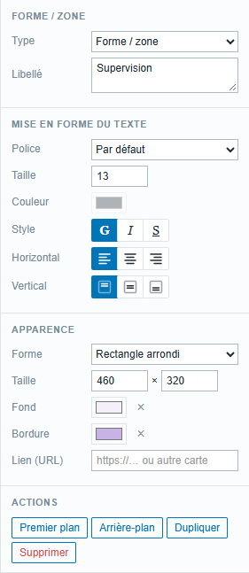

To type text on several lines, press Enter in the **Label** field.

### Changing the appearance of an element

Select the element with a click: the right-hand panel shows its settings.

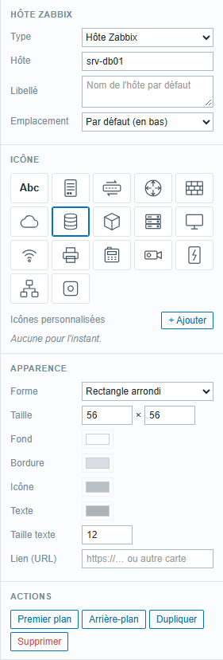

- **Type**: turn the element into another kind (for example a host into a group).
- **Label**: the name shown. Left empty, it is the Zabbix name. Double-clicking the element on the map also lets you edit it.
- **Position**: where the name goes around the icon (bottom, top, left, right). **Default** uses the map's setting.
- **Icon**: choose from the icons provided: server, switch, router, firewall, cloud, database, VM, storage, workstation, Wi-Fi access point, printer, IP phone, camera, UPS, group, generic.
  - **Abc** (no icon): the name is written directly in a box, without a pictogram. This is handy for a very compact diagram.
- **Shape**, **Size**, **Background**, **Border**, colour of the **Icon** and the **Text**, **Text size**. The small **×** next to a colour restores the default colour.
- **Link (URL)**: address opened on click in View mode. Paste for example the address of another map to navigate from map to map (overview → details of a site).

To make an element bigger, you can also drag the small square that appears at its bottom right when it is selected.

### Using your own icons

Below the icons provided, the **Custom icons** section lets you add your own images:

1. Click **+ Add** and choose one or more files. Accepted formats: SVG, PNG, JPEG, GIF, WebP, 1 MB max per file.
2. The icon appears in the list; click it to apply it to the selected element.

Added icons are shared by **all maps**. To delete one, hover over it and click the small cross. Wherever it was used, the generic icon replaces it.

> For security reasons, SVG files that contain scripts or refer to external resources are rejected.

### Actions on an element

At the bottom of the panel:

- **Bring to front** / **Send to back**: move the element in front of or behind the others;
- **Duplicate** (Ctrl+D): create a copy of it;
- **Delete** (Del key): remove it from the map, along with the links attached to it.

## 6. Linking elements

### Drawing a link

1. Hover over an element: **blue points** appear around its edge.

   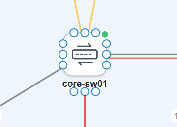

2. Click a blue point and, without releasing, drag towards the element to link. A preview of the link follows the pointer.

   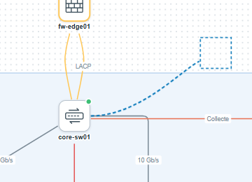

3. Release:
   - **on a blue point** of the other element: the link is attached to that exact point;
   - **in the middle** of the other element: the link is "floating". It always leaves from the nearest side, even if you move the elements;
   - **in empty space**: a new element identical to the first one is created at the end of the link. This is handy to quickly draw several similar devices.

If you draw several links between the same two elements (link aggregation, redundant links), they spread apart automatically.

### Choosing the shape of the link

Click a link to select it. The right-hand panel shows its settings.

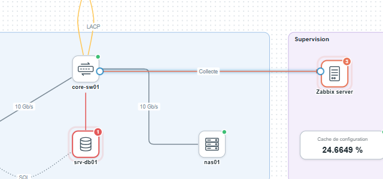

The **Routing** field offers three shapes:

- **Curved**: a smooth line. Drag the link with the mouse to bend it;
- **Straight**: a straight line. Drag it to add a bend;
- **Orthogonal**: only horizontal and vertical segments, routed automatically. Drag the handle in the middle of a segment to shift it, double-click it to remove that jog.

For straight and orthogonal links, **Rounded corners** softens the angles.

On a selected link:

- the **solid points** are waypoints: drag them to move them, double-click to remove them;
- the **hollow points** in the middle of each section: drag them to add a waypoint;
- the **ends**: drag them to another element to reconnect the link;
- the **label** (for example "10 Gb/s"): drag it to slide it along the link.

The **Straighten** button removes all waypoints. **Reverse** changes the direction of the link, which is useful with arrows.

### Setting the appearance of the link

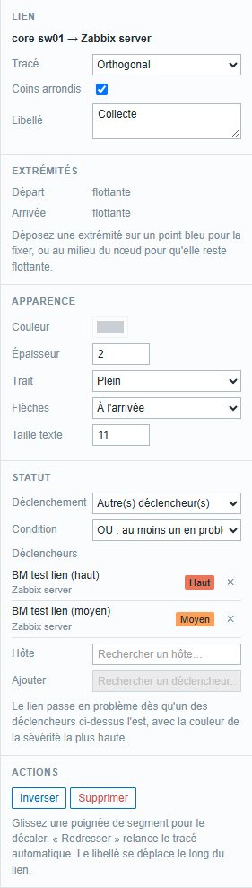

- **Label**: text shown on the link (bandwidth, connection type…). Double-clicking the link also lets you type it.
- **Ends**: shows whether each end is attached to a fixed point or floating. **Release** makes an end floating.
- **Color**, **Width**, **Line** (solid, dashed, dotted), **Arrows** (none, at the end, at the start, at both ends), **Text size**.

### Choosing what colours the link

The **Status** section, **Triggered by** field, defines when the link changes colour:

| Choice | The link is coloured when… |
|---|---|
| **Both end nodes** (default) | either of the linked elements has a problem |
| **The start node** | only the start element has a problem |
| **The end node** | only the end element has a problem |
| **Other trigger(s)** | one or more triggers chosen specifically for this link are in problem |
| **Never** | never: the link keeps its normal colour (for example a purely informative link) |

The link takes the colour of the highest severity.

With **Other trigger(s)**, the link can reflect the exact state of the connection, for example the switch's "interface Gi0/1 down" trigger, rather than the overall state of the devices:

1. In **Host**, choose the host that carries the trigger.
2. In **Add**, choose the trigger. It is added to the list, with its current state.
3. Repeat to add more triggers, possibly from other hosts. The **×** removes one.
4. With several triggers, choose the **Condition**:
   - **OR**: the link is coloured as soon as **at least one** trigger is in problem;
   - **AND**: the link is only coloured if **all** triggers are in problem. This is useful for redundant links: you are only alerted when both paths are down.

## 7. Laying out and saving

### Selecting several elements

- Click and drag **in empty space** to draw a selection rectangle; everything entirely inside it is selected.
- **Shift + click** adds an element to the selection or removes it. **Shift + rectangle** adds to the existing selection.
- **Alt + click and drag** draws a rectangle even when starting on an area. This is useful to select the devices placed in an area without moving the area.
- **Ctrl+A** selects everything.

With several elements selected, the panel offers:

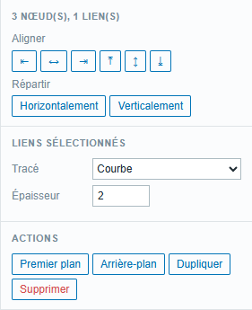

- **Align**: left, centre, right, top, middle, bottom;
- **Distribute** horizontally or vertically, at regular intervals (from three elements);
- for the selected links: change their **Routing** and **Width** in one go.

You can move the selection with the mouse, or with the keyboard **arrow keys** (1 pixel, or 10 pixels with Shift).

### Copy, paste, undo

- **Ctrl+C** / **Ctrl+V**: copy and paste elements, **including from one map to another** (open the other map, then paste).
- **Ctrl+Z** / **Ctrl+Y** (or the **↶** **↷** buttons): undo, redo.

### Map settings

Click in empty space to deselect everything: the panel shows the map settings.

- **Name** of the map;
- **Background**: background colour;
- **Default links**: shape of new links (curved, straight, orthogonal);
- **Host labels**: default position of names (bottom, top, left, right);
- **Refresh (s)**: how often statuses are updated, from 10 to 3,600 seconds;
- **Grid**: **Show** the grid, turn on **Snap to grid** (elements stick to the grid) and set its **Step**.

### Saving

Click **Save** or press **Ctrl+S**. The "Map saved" message confirms the save.

If you leave the page with unsaved changes, the browser asks for confirmation.

> **One person at a time.** If two administrators edit the same map at the same time, the last one to save wins: the other's changes are lost. Agree on who edits which map.

### Backing up or duplicating a map

In the map settings, **Backup** section:

- **Export JSON** downloads the map to a file;
- **Import JSON** replaces the content of the open map with that of a file. Remember to **Save** afterwards. If something goes wrong, **Ctrl+Z** undoes the import.

To duplicate a map: create an empty map, then import into it the file exported from the original map.

## 8. Keyboard and mouse shortcuts

### In all maps

| Gesture | Effect |
|---|---|
| Mouse wheel | zoom in, zoom out |
| Shift + mouse wheel | horizontal scrolling |
| Click and drag (View mode) | scroll the map |
| Click an element or a link | detail window (View mode) |
| Esc | close the detail window, deselect |

### In Edit mode

| Gesture | Effect |
|---|---|
| Click | select |
| Shift + click | add to or remove from the selection |
| Drag in empty space | rectangle selection (Shift: add to the selection) |
| Alt + drag | rectangle selection, even when starting on an area |
| Space + drag, or right-click + drag | scroll the map |
| Double-click an element or a link | edit its label |
| Double-click a waypoint | remove it |
| Double-click the handle of an orthogonal segment | remove that jog |
| Drag from a blue point | create a link |
| Arrow keys (Shift: by 10) | move the selection |
| Ctrl+A | select all |
| Ctrl+C / Ctrl+V | copy / paste (also between two maps) |
| Ctrl+D | duplicate |
| Del | delete the selection |
| Ctrl+Z / Ctrl+Y | undo / redo |
| Ctrl+S | save |

### In a dashboard widget

| Gesture | Effect |
|---|---|
| Ctrl + mouse wheel | zoom in, zoom out |
| Click an element | detail window |

## 9. Frequently asked questions

**An element shows "?" or "not found or no permission".**
The Zabbix object has been deleted, or your account is not allowed to see it. Each user only sees the state of the hosts their user groups give them access to. Two people can therefore see the same map with different information.

**A host is down but does not show in red.**
Check in **Monitoring › Problems** that the problem is not suppressed (for example during maintenance) or marked as a symptom: such problems are not counted. Also check the **Status** time in the toolbar, which should move forward about every 30 seconds.

**An item shows "—".**
Zabbix has not received any value for this item yet. If its detail window shows "Item not supported", the item is in error in Zabbix.

**The message "Unexpected server response (session expired or insufficient permissions?)" appears.**
Your Zabbix session has expired. Reload the page and log in again. If you were editing a map, export it to JSON first so you lose nothing.

**I cannot see the Edit button.**
Editing is reserved for Admin and Super admin accounts that have the "Create and edit maps" permission. Other users view maps read-only.

**Who can see my maps?**
All maps are visible to every user who has access to **Maps+**. There are no private maps.

**The mouse wheel does not zoom on the dashboard.**
This is intentional: on a dashboard, the mouse wheel scrolls the page. Use **Ctrl + mouse wheel**, or the buttons that appear when hovering over the map.

**The widget says "Map not found".**
The map has been deleted. Edit the widget to choose another map.
